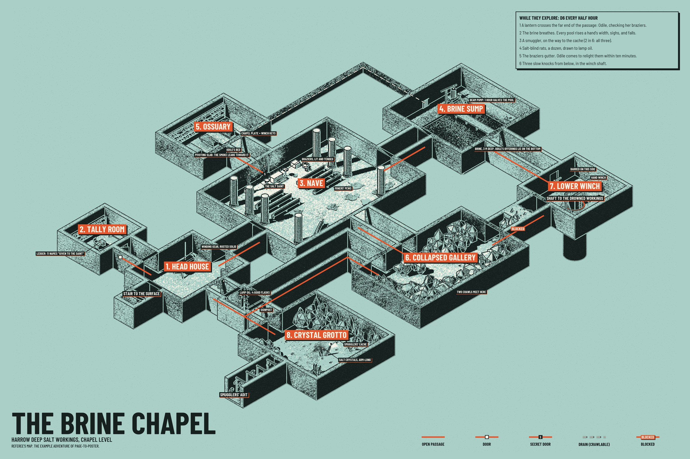
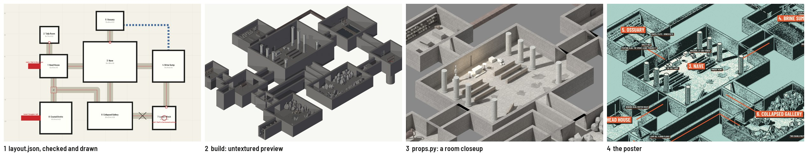
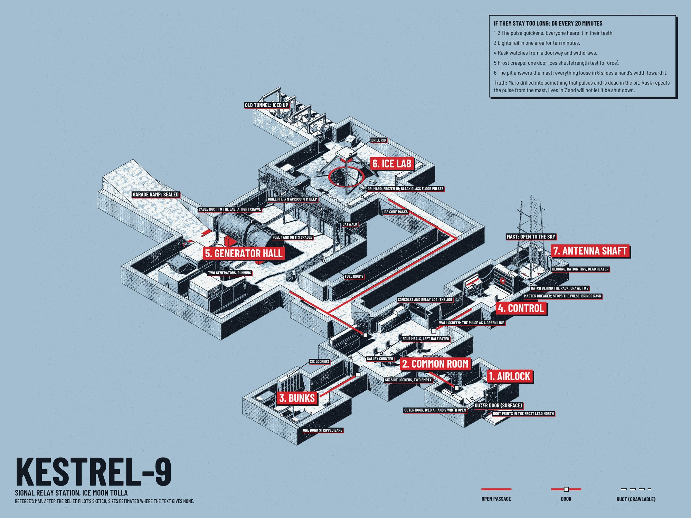
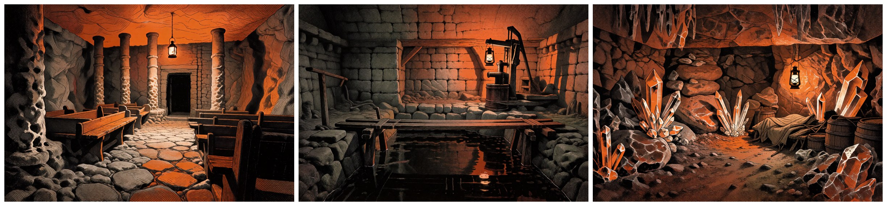

# page-to-poster

Give an AI coding agent a written adventure location (a few PDF pages or a text file) and a rough idea of the map
you want. It reads the text, builds the place as a 3D model in Blender, and prints it as an isometric cutaway
poster in a four-ink screenprint style, in a GM version, a player version and a bare one.



This poster was made from the one-page adventure in
[`examples/brine-chapel/source/adventure.md`](examples/brine-chapel/source/adventure.md), which has no map.

## How it works

The agent's part is reading and deciding. It writes five small files per site:

| File | What it holds |
|---|---|
| `guidelines.md` | What you asked for: what to map, the look, size, what to hide from players |
| `brief.md` | What the adventure says about each room, connection and way in, with estimates marked |
| `layout.json` | Rooms, passages and entrances as rectangles and paths, in meters |
| `props.py` | What stands in each room, placed with a kit of ready-made props and simple solids |
| `poster.json` | Title, callouts, text boxes, palette, viewing direction |

The code's part is everything mechanical: checking the layout and drawing it, building the model headless in
Blender, rendering, and composing the print.



[`SKILL.md`](SKILL.md) is the procedure the agent follows, step by step, with a picture to check after each step.

## What you need

| | |
|---|---|
| **Required** | Python 3.10+ with numpy, scipy, Pillow (and PyMuPDF for PDFs), and Blender (developed on 5.2 LTS) |
| Not required | A GPU (renders fall back to the CPU), ComfyUI, any Blender add-on or MCP server |
| Optional | ComfyUI with Krea 2 Turbo, for painted textures and for paintings of each room locked to the model |

Setup, including Blender install commands for each system: [docs/setup.md](docs/setup.md).
The optional ComfyUI models and nodes: [docs/comfyui.md](docs/comfyui.md).

## Try it

```
git clone <this repository's URL> page-to-poster
cd page-to-poster
pip install -r requirements.txt
python p2p.py doctor                        # must end with "Core pipeline: ready"
python p2p.py all examples/brine-chapel     # check, textures, build, render, compose
```

The posters land in `examples/brine-chapel/out/`. From nothing to three finished 36 x 24 inch posters at 200 dpi
took 1 min 40 s on our workstation with GPU rendering ([timings](docs/setup.md#rendering-device)); add `--dpi 100`
for a quick draft.

## Use it as an agent skill

The repository root is the skill folder (it holds `SKILL.md`). Put it where your agent looks for skills, for
example:

```
git clone <this repository's URL> ~/.claude/skills/page-to-poster
```

Then ask for a map:

> Use the page-to-poster skill. The adventure is `D:/books/harrow-deep.pdf`, pages 12-15. Map the chapel level.
> Stone and salt, not industrial. I want a version I can show the players.

An agent without a skills folder works too: tell it to read `SKILL.md` in this folder and follow it.

The agent will come back with the posters and a list of what it had to estimate. To change something, say so, or
edit the project's files yourself and rerun the command; every step is repeatable.

[`examples/kestrel-9`](examples/kestrel-9) is what that looks like in practice. An agent that had never seen this
repository was given `SKILL.md`, a three-page PDF with a rough sketch map
([`source/kestrel-9.pdf`](examples/kestrel-9/source/kestrel-9.pdf)) and the five-line request in
[`request.md`](examples/kestrel-9/request.md). The files in that folder are what it wrote, unedited, in 14 minutes:



## Use it by hand

```
python p2p.py new maps/my-site --source adventure.pdf --pages 12-15
# write brief.md, layout.json
python p2p.py check maps/my-site            # look at maps/my-site/build/layout_check.png
python p2p.py textures maps/my-site
# write props.py
python p2p.py build maps/my-site            # look at build/iso_preview.png
python p2p.py render maps/my-site closeup   # look at renders/closeup_<id>.png
# write poster.json
python p2p.py poster maps/my-site --dpi 100 # look at out/poster_gm.png; then --dpi 200
```

File formats: [docs/layout.md](docs/layout.md), [docs/props.md](docs/props.md) (with a picture of every
ready-made prop), [docs/kit-reference.md](docs/kit-reference.md), [docs/poster.md](docs/poster.md).

## Optional: room paintings

With ComfyUI, Krea 2 Turbo and its depth Control LoRA, `p2p.py paint` paints each room as you would see it on
walking in. The model's depth map steers the painting, so pillars, doorways and props are where the map has them.



## Limits

- Rooms are rectangles. Caves, collapses and odd shapes are made by filling or dividing a rectangle.
- One poster shows one level. Join levels with labelled stairs and shafts.
- The player version removes labels and route marks, not rooms: a secret room is drawn without its name, and a
  secret passage is still drawn. [docs/layout.md](docs/layout.md#secrets) shows how to lay out a secret door so
  that almost nothing of it shows.
- The agent estimates whatever the text leaves open, and should tell you what. Check the brief.
- Developed and tested on Windows with Blender 5.2 and NVIDIA cards. The code avoids anything
  platform-specific, but macOS and Linux have not been run.

## Layout of this repository

```
SKILL.md            the procedure an agent follows
p2p.py              the command line: doctor, new, check, textures, build, render, poster, paint, all
mapkit/             layout checker, texture maker, poster compositor, ComfyUI client
mapkit/blender/     the modelling kit, builder and renderer (run inside Blender)
mapkit/templates/   the five starting files `p2p.py new` copies into a project
examples/           brine-chapel (a worked example), kestrel-9 (made by an agent from the skill alone), prop-zoo
                    (every prop, as a test scene)
docs/               setup, file formats, kit reference
fonts/              Barlow Condensed and Semi Condensed (SIL Open Font License)
tools/              kit_reference.py regenerates docs/kit-reference.md
```

## License

Code: MIT. Fonts: SIL Open Font License 1.1 (`fonts/OFL.txt`). The two example adventures: CC0.

Maps you make from a published adventure are derived from someone else's work: fine for your own table, not
yours to publish. Keep project folders that contain a publisher's text or maps out of public repositories.
