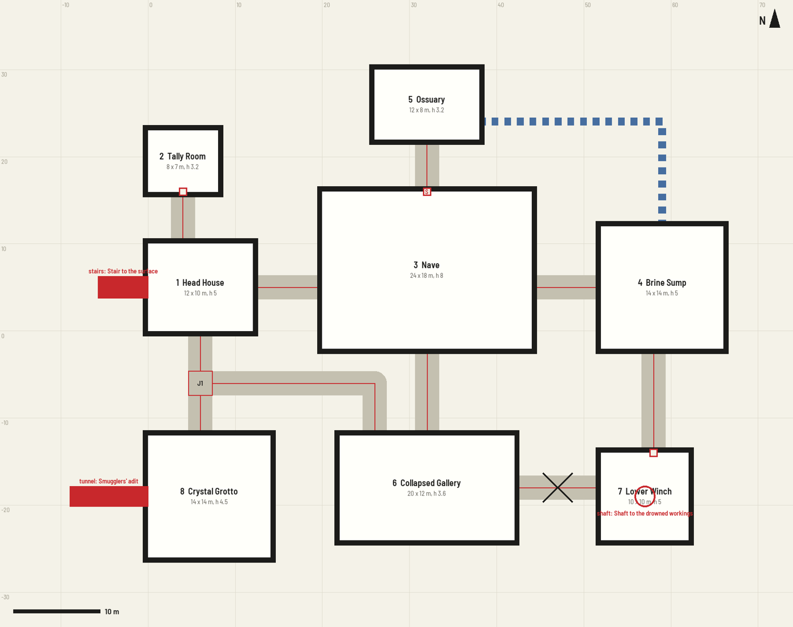

# layout.json

The plan of the site: rooms, the passages between them, and the ways in. Everything is in meters, +x is east,
+y is north, and floors are at height 0. `python p2p.py check PROJECT` validates the file and draws it to
`PROJECT/build/layout_check.png`.

A complete example is [`examples/brine-chapel/layout.json`](../examples/brine-chapel/layout.json); this is its
check drawing:



## Top level

| Key | Default | Meaning |
|---|---|---|
| `name` | | The site's name |
| `source` | | Where the layout came from (page, map, or "estimated from the text"). For people; not used by the code |
| `rooms` | required | List of rooms, below |
| `links` | `[]` | Passages, ducts and blocked ways between rooms |
| `entrances` | `[]` | Ways in from outside the map |
| `junctions` | `{}` | Named points where passages meet: `{"J1": [x, y]}` |
| `corridor_width` | 3.2 | Width of passages |
| `corridor_height` | 3.6 | Ceiling height of passages, and of rooms that give no height |
| `floor`, `wall` | `concrete_floor`, `concrete_wall` | Materials of passages and of rooms that name none. Any name from the [materials table](kit-reference.md#materials), or one you register with `material()` in `props.py` |
| `door_width`, `door_height` | 1.6, 2.4 | Size of the doors that links ask for |
| `vent_width` | 0.9 | Width and height of ducts |
| `vent_z` | `corridor_height` - 1 | Height of a duct's center above the floor. The default is an overhead duct; 0.6 makes a floor-level crawlway or drain. One vent can differ: give that link a `"z"` |
| `corridor_decals` | oil stains, cracks, rust | Decal names scattered along passages; `[]` for none |

## Rooms

```json
{"id": 3, "name": "Nave", "min": [20, -2], "max": [44, 16], "height": 8, "floor": "stone_floor", "wall": "stone_wall"}
```

| Key | Meaning |
|---|---|
| `id` | A number or a short word (letters, digits, underscore). The poster shows it; `props.py` uses it (`room_3`) |
| `name` | Printed on the poster |
| `min`, `max` | The south-west and north-east corners of the clear floor. Walls are added outside this rectangle |
| `height` | Ceiling height. Props use it (`r.h`); the poster cuts walls lower anyway |
| `floor`, `wall` | Materials for this room |

Rules the checker enforces:

- Rooms are rectangles at least 2 m each way.
- Any two rooms are at least 0.6 m apart (walls are 0.6 m thick, so 0.6 m apart means they share a wall).

## Links

```json
{"kind": "open", "a": 1, "b": 2, "path": [[4, 10], [4, 16]], "doors": ["b"]}
{"kind": "open", "a": 3, "b": 5, "path": [[32, 16], [32, 22]], "doors": ["a"], "secret": true}
{"kind": "open", "a": "J1", "b": 6, "path": [[6, -6], [26, -6], [26, -12]]}
{"kind": "blocked", "a": 6, "b": 7, "path": [[42, -18], [52, -18]]}
{"kind": "vent", "a": 4, "b": 5, "path": [[59, 12], [59, 24], [38, 24]]}
```

| Key | Meaning |
|---|---|
| `kind` | `open`: a passage. `blocked`: a passage plugged by a collapse. `vent`: a duct between two rooms |
| `a`, `b` | The room ids (or junction names) at the two ends |
| `path` | Points from `a` to `b`. Straight runs between points; add points for bends |
| `width` | Width of this passage, if not `corridor_width` |
| `doors` | `["a"]`, `["b"]` or `["a", "b"]`: a door where the passage meets that room |
| `secret` | `true`: the players must not know of this link. Its doors look like wall and are marked "S"; the player poster leaves out its route mark. Works on any kind of link. The passage itself is still modelled: see "Secrets" below |
| `closed` | `true`: the doors are shut instead of ajar |
| `block_at` | For `blocked`: `[x, y]` of the collapse. Default: halfway along |
| `fill` | For `blocked`: the material that plugs it. Default `rubble`; `ice`, `rock`, `dirt` ... |
| `z` | For `vent`: height of this duct's center above the floor, instead of `vent_z` |

Rules:

- A path starts **on the edge** of room `a` and ends on the edge of room `b`. A room's edge is its `min`/`max`
  rectangle, so a path leaving the east wall of a room with `"max": [12, 9]` starts at `[12, y]`.
- A path leaves a room **at a right angle** to that wall, and runs at least 0.7 m before its first bend.
- The opening must fit in the wall: keep its center at least half the passage width from the room's corners.
- A passage must stay clear of every other room by half its width plus one wall (2.2 m for the default width).
- Two rooms that touch (0.6 m apart) are joined by a 0.6 m path straight through the shared wall.
- Vents run from room to room, take no doors and ignore the clearance rule (they are small and overhead).

### Secrets

The model is the same for every version of the poster, so a secret passage or room is always *drawn*; marking a
link `secret` only keeps its red route line, door mark and legend entry off the player version. To make a secret
connection nearly invisible in the artwork as well, put the two rooms 0.6 m apart so they share a wall, and join
them with a 0.6 m link that has a secret door: no passage is drawn, only a faint door-sized outline in the wall.
To keep a whole room from the players, hide its name (`room_labels` in [poster.md](poster.md)) or build a second
project without it.

## Junctions

Where three or more passages meet, or a passage needs a crossing, name the point:

```json
"junctions": {"J1": [6, -6]},
"links": [
 {"kind": "open", "a": 1, "b": "J1", "path": [[6, 0], [6, -6]]},
 {"kind": "open", "a": "J1", "b": 8, "path": [[6, -6], [6, -12]]},
 {"kind": "open", "a": "J1", "b": 6, "path": [[6, -6], [26, -6], [26, -12]]}
]
```

A path that ends at a junction ends at the junction's point. A path may also pass through a junction on its way,
by having the junction's point as one of its bends. A junction becomes a small square of floor, so keep it
`corridor_width / 2 + 1.2` m away from rooms, and make the path segments that touch it at least
`corridor_width / 2 + 1.3` m long. Two passages that cross without a junction get a warning.

## Entrances

```json
{"room": 1, "kind": "stairs", "side": "W", "at": 5, "label": "Stair to the surface"}
{"room": 7, "kind": "shaft", "at": [57, -19], "dir": "down", "depth": 8, "label": "Shaft to the drowned workings"}
```

`side` is the wall (`N`, `S`, `E`, `W`) and `at` the position along it: the x of a north or south wall, the y of an
east or west wall. `label` is printed on the poster.

| Kind | Looks like | Options (defaults) |
|---|---|---|
| `stairs` | A flight in a walled well outside the wall | `dir` `up`/`down` (up), `width` (2.6), `steps` (16) |
| `ramp` | A vehicle ramp | `dir` (up), `width` (4), `length` (10), `rise` (3), `sealed` (false; true: a slab closes the far end) |
| `tunnel` | A passage leading off the map | `width` (2.4, or the corridor width if that is narrower), `length` (8), `rough` (false; true: hand-dug, with timber shoring), `blocked` (false; true: caved in part-way, marked like a blocked link), `fill` (`rubble`: what blocks it) |
| `door` | An outside door with a step | `width` (1.6), `height` (2.4), `closed` (false), `ajar` (55 degrees) |
| `shaft` | A round hole with a ladder; `at` is `[x, y]` inside the room | `dir` (up: a ladder to the ceiling; down: a pit), `radius` (1.2), `depth` (6), `daylight` (false; true: light falls in from above) |

## What the checker reports

Errors stop the build; warnings are worth a look. Typical messages and what to do:

| Message | Fix |
|---|---|
| `rooms 1 and 2 are 0.20 m apart` | Move one so the gap is 0.6 m or more |
| `end a at (11, 4.5) is not on the edge of room 1 (x 0..12, y 0..9)` | Put the point on the rectangle's edge: x = 12 here |
| `the path must leave room 1 at a right angle to its E wall` | Make the second point share the first point's y (for an E or W wall) or x (N or S) |
| `the 3.2 m opening at (12, 8.5) runs past the corner` | Slide the opening along the wall into the range given |
| `the corridor runs through or scrapes room 3` | Reroute with more bends, or move the room |
| `links 0 and 4 cross ... without a junction` | Add a junction at that point and split or bend the paths through it |
| `room 6 cannot be reached from room 1 and has no entrance` | Add the missing link, or an entrance; ignore it if the room really is sealed |
