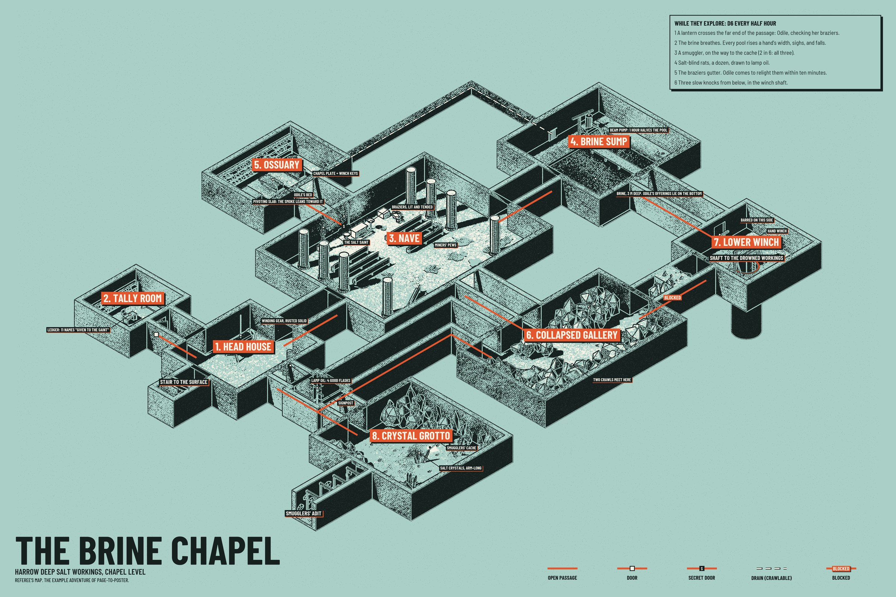

# poster.json and the renders

`python p2p.py poster PROJECT` renders the model as an isometric cutaway and composes the poster from it.
`poster.json` holds everything printed on top of the artwork, plus the view. Every key is optional.

Complete example: [`examples/brine-chapel/poster.json`](../examples/brine-chapel/poster.json).



## Versions

| File | Contains |
|---|---|
| `out/poster_gm.png`, `.jpg` | Everything |
| `out/poster_player.png`, `.jpg` | No `gm_only` callouts, no links marked `"secret"`, the player's text box and footer |
| `out/poster_bare.png`, `.jpg` | The artwork alone |

The artwork is the same in all three. **The player version hides words and route marks, not geometry**: a secret
room is still drawn, as an unlabelled room, and so is a secret passage. Hide a room's name with `room_labels`.
[layout.md](layout.md#secrets) shows how to lay out a secret door so that almost nothing of it is drawn. If the
players must not see a room at all, leave it out of `layout.json` and build a second project for them.

## Keys

### Text

| Key | Meaning |
|---|---|
| `title`, `subtitle`, `footer` | The title block. Each is a string, or `{"gm": "...", "player": "..."}` |
| `box` | The text box: `{"heading": "...", "lines": ["...", "..."], "width": 1500}`, or one per version: `{"gm": {...}, "player": {...}}`. Lines wrap; `width` is in pixels on a 36 x 24 inch sheet at 200 dpi and scales with the sheet |
| `callouts` | List of `{"feature": "3.altar", "text": "...", "gm_only": false}`. `feature` is a name registered with `feat()` in `props.py`; or give `"at": [x, y, z]` in meters instead. Tags place themselves where they cover the fewest labels, marks and dots; `"side": "nw"` forces one to that side of its dot (`n`, `s`, `e`, `w`, `ne`, `nw`, `se`, `sw`; `n` is up the sheet) |
| `room_labels` | `{"5": "Crypt"}` renames a room on the poster; `""` removes its label; `{"5": {"gm": "Ossuary", "player": ""}}` differs by version |
| `number_rooms` | `true`: labels read "3. NAVE". `false`: "NAVE" |
| `room_label_offsets` | `{"3": [dx, dy]}` moves a room's label by that many meters east and north. On the sheet, in the default view, east is right-and-up and north is left-and-up: `[d, -d]` moves the label right, `[-d, d]` left, `[d, d]` up, `[-d, -d]` down |
| `label_scale` | Multiplies the size of every label, mark and text. Raise it (1.3 to 2) for a small site, lower it for a sprawling one |
| `blocked_mark` | The word on a blocked passage. Default "BLOCKED" |
| `legend` | `false` removes the legend |
| `legend_labels` | Rename legend entries: `{"vent": "DRAIN (CRAWLABLE)"}`. Keys: `open`, `door`, `secret`, `vent`, `blocked` |
| `corners` | Which corner each block sits in: `{"title": "bl", "box": "tr", "legend": "br"}` (the default). `tl`, `tr`, `bl`, `br` |

Entrance labels come from `layout.json` (`"label"` on each entrance).

### Sheet and print

| Key | Default | Meaning |
|---|---|---|
| `size_in` | `[36, 24]` | Sheet size in inches, width first |
| `palette` | `{"paper": "#D4DA68", "ink": "#181816", "white": "#F1EFE2", "accent": "#D7262E"}` | The four inks |
| `art_box` | `[0.015, 0.015, 0.985, 0.985]` | The part of the sheet the artwork may fill, as fractions: left, top, right, bottom. `[0.02, 0.02, 0.98, 0.88]` leaves a strip along the bottom for the title |
| `exposure` | 1.0 | Above 1 prints lighter (less ink), below 1 darker |

Choosing a palette: paper is a mid-tone, light enough for black text; ink is near-black; white is for
highlights and label text; the accent is the loudest color on the sheet and must stand out from the paper. Two
that we have used: acid yellow-green `#D4DA68` with red `#D7262E` (the default), and brine green `#A9CFC6` with
vermilion `#E4572E` (the example). Check a new palette on a `--dpi 100` draft with `--reuse-render`; it takes
seconds.

### View

| Key | Default | Meaning |
|---|---|---|
| `view.azimuth` | -45 | Which way the viewer faces, in degrees. -45: looking north-east, so the south-west corner of the site is nearest. 45: looking north-west. 135: looking south-west. -135: looking south-east |
| `cutaway.wall` | 3.2 | Height at which walls are cut open. Each of the two walls nearest the viewer hides a strip of floor about as wide as this height, so use 1.5 to 2 for a site of small rooms |
| `cutaway.tall` | 20 | Height at which everything else is cut |
| `cutaway.props` | | `{"3": 4.5}` cuts the props of room 3 at 4.5 m |
| `eye` | | Camera overrides for the eye-level view, per room: `{"4": {"inward": 3.0, "z": 2.4, "aisle": true}}` |

Changing anything in this table needs a new render (run `poster` without `--reuse-render`).

## Command

```
python p2p.py poster PROJECT [--dpi 200] [--variant gm|player|bare|all] [--bleed 0.125] [--reuse-render]
                             [--samples N] [--device auto|cpu|optix|cuda|hip|metal|oneapi] [--gpu NAME]
```

- `--dpi` sets the pixel size: sheet inches times dpi. Draft at 100, print at 200.
- `--reuse-render` keeps the last render and only redoes the composition: use it after editing text, labels,
  palette, `exposure`, `corners` or `art_box`. If you change `--dpi` or `art_box` a lot, render again so the artwork
  is not scaled up.
- `--bleed 0.125` adds that many inches of plain paper on every side, for print shops that trim; the files get
  `_bleed` in their names.
- The JPEG is quality 93 without chroma subsampling, small enough for the upload limits of retail print counters.

## The other renders

```
python p2p.py render PROJECT VIEW [--rooms 1,2] [--width N] [--ppm N] [--samples N] [--device D] [--gpu NAME]
```

| View | Output | Use |
|---|---|---|
| `closeup` | `renders/closeup_<id>.png` | The cutaway framed on one room: check props while writing `props.py`. `--width` in pixels (1400) |
| `plan` | `renders/plan.png`, `plan.json` | Top-down plan of the site with walls in solid black. `--ppm` pixels per meter (30) |
| `rooms` | `renders/room_<id>.png`, `.json` | Top-down battle map of each room. `--ppm` (70; a 5 ft square is 1.524 m) |
| `eye` | `renders/eye_<id>.png`, `eye_<id>_depth.png` | The room as you walk in, by flashlight; the depth map drives the optional paintings ([comfyui.md](comfyui.md)) |
| `poster` | `renders/poster_color.png`, `_depth.png`, `_normal.png`, `poster.json` | What `p2p.py poster` renders before composing |

The `.json` next to a render records its camera, so pixels can be converted to meters and back
(`mapkit.poster.to_px`).

## How the look is made

The model is rendered three times from the same camera: in color under a fixed sun, as distance from the camera,
and as surface direction. The compositor then:

1. turns brightness into ink or paper through a grain and a diagonal line screen, so mid-tones become stipple and
   hatching;
2. prints the brightest surfaces white and strongly red surfaces in the accent ink;
3. draws an ink line wherever depth jumps or the surface turns, and knocks the same lines out to paper inside
   solid black;
4. adds specks, then the route lines, labels and text.

Brightness is mapped with fixed thresholds, so a material prints the same on every map.
