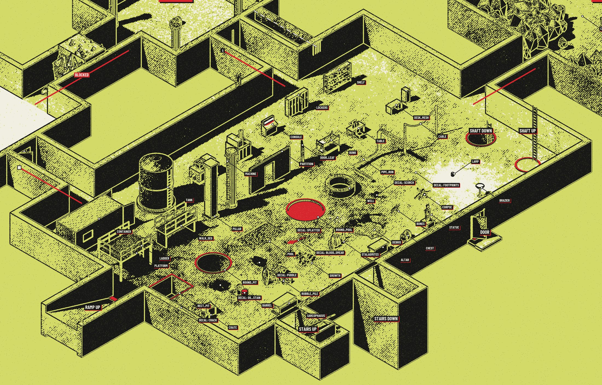

# props.py

`layout.json` gives you empty rooms. `props.py` fills them: one Python function per room that places what the
adventure says is there. The functions run inside Blender during `p2p.py build`, using the kit in
`mapkit/blender/kit.py`. [kit-reference.md](kit-reference.md) lists every call; this page explains how to use them.

Complete example: [`examples/brine-chapel/props.py`](../examples/brine-chapel/props.py).

## The shape of the file

```python
from mapkit.blender.kit import *


def room_3(r, rng, P):
    mb = MB("r3_props")
    pillar(mb, r.minx + 2.0, r.cy, h=r.h)
    crate(mb, r.cx, r.cy, rz=0.3)
    mb.obj(P)
    feat("3.crate", r.cx, r.cy, 0.6)


def room_4(r, rng, P, cut):
    mb = MB("r4_props")
    pool(mb, cut, r.minx + 2, r.miny + 2, r.maxx - 2, r.maxy - 2, depth=2.0)
    mb.obj(P)


def extras(rooms, rng, P):
    ...
```

- A function named `room_<id>` is called for the room with that id. Rooms without a function stay empty.
- `r` is the room. `r.minx`, `r.miny`, `r.maxx`, `r.maxy` are its edges, `r.cx`, `r.cy` its center, `r.w`
  (east-west) and `r.d` (north-south) its size, `r.h` its ceiling height. `r.rand(rng, margin)` is a random point
  on its floor. Place things relative to these, so they move with the room when you change the layout.
- `rng` is a `random.Random` seeded per room. Use it for every random choice; never call `random.random()`
  directly, or two builds of the same files will differ.
- `P` is the collection the room's objects go into.
- `cut`, if the function names a fourth parameter, is the floor cutter: pits, pools and wells take it and cut
  their hole out of the room's floor.
- `extras(rooms, rng, P)`, if present, runs last, for things outside any one room. `rooms` maps ids to rooms.

## Building things

Everything is added to a **mesh builder** and turned into one Blender object at the end:

```python
mb = MB("r3_props")      # start
crate(mb, 5.0, 2.0)      # add as much as you like
mb.obj(P)                # finish: one object in this room's collection
```

Forgetting `mb.obj(P)` is the usual reason a room comes out empty; the build prints
`issue: ... mesh builder 'r3_props' has geometry but never became an object` when that happens. Use more than one
builder when part of a room should be cut differently (see "Tall things" below).

**Ready-made props** come in two kinds. Those that stand upright on the floor take a position:
`barrel(mb, x, y)`, `pillar(mb, x, y, h=r.h)`. Those with a front and a back take a **transform** `M`, which you
build with `T(x, y, z, rz=angle)`:

```python
console(mb, T(r.cx, r.maxy - 0.6, 0, rz=math.pi))            # against the north wall, facing south
lockers(mb, T(r.minx + 0.55, r.miny + 0.5, 0, rz=math.pi / 2), n=8)   # along the west wall, doors facing east
```

Each prop's entry in the reference says where its origin is and which way it faces ("x 0..length, doors on the
-y side"). `rz` turns it counter-clockwise seen from above: 0 leaves local +x pointing east, `math.pi / 2` north.

This is every ready-made prop, entrance kind and link kind, labelled with the name of its function
(`examples/prop-zoo` builds it):



**Anything else** you assemble from primitives. A pew is five boxes:

```python
def pew(mb, x, y, length=5.0, rz=0.0):
    M = T(x, y, 0, rz=rz)
    boxmm(mb, "planks", (-length / 2, -0.2, 0.42), (length / 2, 0.2, 0.47), M)     # seat
    boxmm(mb, "planks", (-length / 2, -0.25, 0.3), (length / 2, -0.2, 0.95), M)    # back
    for ex in (-length / 2, -0.03, length / 2 - 0.06):                             # three boards to stand on
        boxmm(mb, "wood", (ex, -0.25, 0.0), (ex + 0.06, 0.2, 0.47), M)
```

The primitives you will use most: `box` and `boxmm` (boxes), `cyl` (upright cylinder; lay it down with
`M=T(x, y, z, ry=math.pi / 2)`), `frustum` (cones, spikes, crystals), `tube` (rings), `sweep` (a round bar through
points: rails, ropes, legs), `pipe_run`, `prism` (any outline extruded upwards), `blob` (boulders, sacks),
`strip` (a band along a path: a conveyor, a carpet, a low wall). Rough shapes are enough: at poster scale one
meter is 40 to 80 pixels, and the print reduces everything to outline and tone.

## Shaping a room

A room is a rectangle, but it does not have to look like one:

- `cave_fill(mb, r, passages, rng)` fills the room with rock except along the paths you give it. Use it for
  caves, mine workings and collapsed halls. Start and end the paths at the room's doorways.
- `partition(mb, x0, y0, x1, y1, doors=[(1.8, 1.2)])` is an interior wall with doorways: cells, closets, stalls.
- `platform(...)`, `walk_seg(...)`, `ladder(...)` and `stairs(...)` make upper levels inside a tall room.
- `rect_pit`, `round_pit`, `pool`, `round_pool` and `well` cut downwards.

## How it prints

The poster has four inks. What a surface becomes depends on its material and on the light:

| In the model | On the poster |
|---|---|
| Strongly red materials: `hazard`, `liquid_acid`, `emissive_red` | the accent ink |
| Bright materials: `tile`, `bone`, `ice`, `glass`, `mushroom`; anything under a lamp | white |
| Mid-grey materials in the light: concrete, stone, wood, metal | paper with a stipple |
| Dark materials (`water`, `black_plastic`, `liquid_runoff`), shade, cut walls | solid ink |
| Every edge and outline | an ink line |

So: make the one thing players must not miss red, make the important things bright, and let the rest be grey.
To add a material of your own, register it at the top of `props.py`:

```python
material("salt", (0.86, 0.86, 0.82), tex="rock", scale=1.5)    # bright: prints white
material("warning_paint", (0.8, 0.07, 0.05))                    # red: prints in the accent ink
```

A material registered here can be used anywhere a material name is accepted, including `"floor"` and `"wall"` in
`layout.json` and the `wall=`, `floor=` and `mat=` arguments of props.

## Decals and lights

`decal("oil_stain", x, y, size=2.0, rot=0.5)` lays an ink sticker on the floor; `wall_decal("rust_streak", r,
"N", along, z, size)` puts one on a wall. The stock decals are `crack`, `oil_stain`, `puddle`, `blood_smear`,
`rust_streak`, `splatter`, `scorch` and `footprints`. `size` is the length of the image's longer side in meters.
At `rot=0` the top of the image (`PROJECT/decals/<name>.png`) points north; `rot` turns it counter-clockwise, in
radians. Directional decals (`footprints`, `blood_smear`, `crack`) need a look at the image and at a closeup to
aim them.

`lamp("r3_fire", "POINT", (x, y, 1.0), 300.0, WARM)` adds a light. Lamps show as white pools on the poster and
light the optional eye-level views. `brazier` and `machine` bring their own.

## Named features

`feat("3.altar", x, y, z)` records a point. `poster.json` can then hang a callout on it:
`{"feature": "3.altar", "text": "Salt altar"}`. Name features `<room id>.<thing>`. `p2p.py build` prints the
full list. Put `z` near the top of the thing so the callout's dot sits on it.

## Tall things

The poster cuts walls at 3.2 m so you can see in. Props are not cut unless they pass 20 m, so a tank or a pillar
rises above the walls, which usually looks good. When tall props hide what stands behind them, cut one room's
props lower in `poster.json`: `"cutaway": {"props": {"3": 4.5}}`. To keep one object whole whatever the cut,
finish its builder with `mb.obj(P, nocap=True)`.

## Checking

```
python p2p.py build PROJECT
python p2p.py render PROJECT closeup --rooms 3
```

Open `build/iso_preview.png` and `renders/closeup_3.png`. Look for: props outside the walls or inside each other;
things floating (a `z` that should be 0) or sunk; doorways blocked; a room too empty or too crowded to read.
A closeup takes a few seconds, so check each room as you write it.

If the build stops with a Python error, the message gives the line in `props.py`. The usual causes: a misspelled
function name, a material that does not exist (`ValueError: unknown material 'stone'` lists the ones that do), a
pit or pool in a room function that has no `cut` parameter (`NameError: name 'cut' is not defined`), or a missing
`rng` argument.
